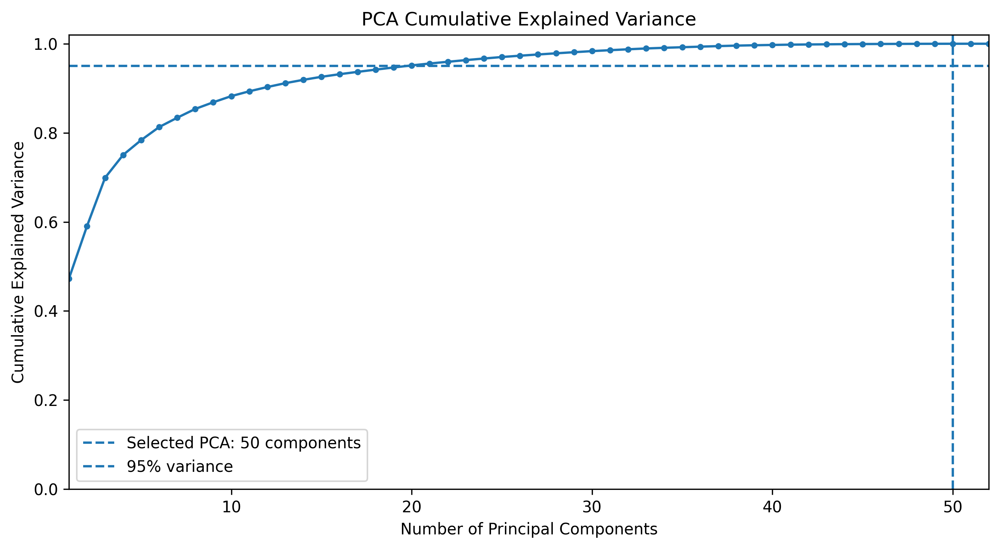
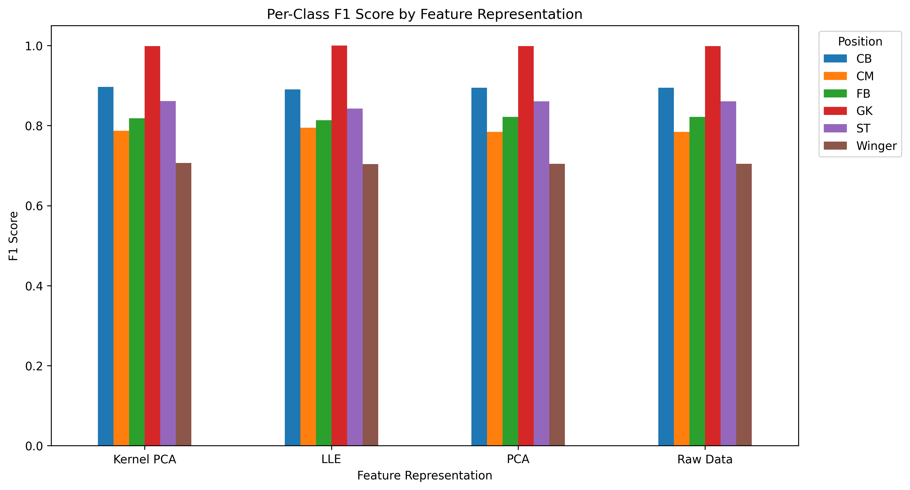

# FIFA 21 Player Position Classification

Machine learning analysis comparing raw player attributes with PCA, Kernel PCA, and Locally Linear Embedding (LLE) for multiclass football position classification.

Using **K-Nearest Neighbors (KNN)** as a consistent classifier, this project evaluates whether dimensionality reduction can simplify FIFA 21 player attributes while preserving predictive performance.

**Best held-out weighted F1: 0.8295**


---

## Project Overview

Player positions are associated with different combinations of technical, physical, attacking, defensive, and movement attributes.

This project investigates two questions:

1. Can FIFA 21 player attributes distinguish broad positional roles?
2. Can dimensionality reduction compress the feature space without sacrificing classification performance?

Four feature representations are compared:

- Raw standardized features
- Principal Component Analysis (PCA)
- Kernel PCA with an RBF kernel
- Locally Linear Embedding (LLE)

KNN is used for every representation so that differences in performance primarily reflect the feature representation.

---

## Dataset

The project uses the **FIFA 21 Complete Player Dataset** (`players_21.csv`).

After preprocessing, the modeling dataset contains:

- **18,944 players**
- **52 numeric features**
- **6 position classes**

### Position Mapping

| Class | Included Positions |
|---|---|
| GK | GK |
| CB | CB |
| FB | LB, RB, LWB, RWB |
| CM | CDM, CM, CAM |
| Winger | LM, RM, LW, RW |
| ST | ST, CF |

For players with multiple listed positions, the dominant positional group is selected, with team position used as a tie-breaker when applicable.

### Class Distribution

| Position | Players |
|---|---:|
| CM | 4,821 |
| Winger | 3,291 |
| CB | 3,152 |
| FB | 3,013 |
| ST | 2,583 |
| GK | 2,084 |

Because the classes are not perfectly balanced, **weighted F1-score** is used as the primary model-selection metric.

---

## Methodology

The data is split using stratified sampling. The original training and validation partitions are combined into a development set for model selection, while a held-out test set is reserved for final evaluation.

- **Development set:** 16,102 players
- **Held-out test set:** 2,842 players

The workflow is:

1. Split the data with stratification.
2. Tune hyperparameters using the development set.
3. Fit preprocessing and dimensionality-reduction transformations only on the appropriate training folds.
4. Select the best configuration using weighted F1-score.
5. Refit the selected model on the full development set.
6. Evaluate once on the held-out test set.

Raw features and PCA use **5-fold stratified cross-validation**. Kernel PCA and LLE use **3-fold stratified cross-validation** because the nonlinear transformations are substantially more computationally expensive.

---

## Models

### Raw Features

`52 features -> StandardScaler -> KNN`

Selected configuration:

- KNN neighbors: **21**

### PCA

`52 features -> StandardScaler -> PCA -> KNN`

Selected configuration:

- PCA components: **50**
- KNN neighbors: **21**

The selected 50 components retain approximately **99.996% of total variance**.

### Kernel PCA

`52 features -> StandardScaler -> RBF Kernel PCA -> KNN`

Selected configuration:

- Components: **50**
- Gamma: **0.001**
- KNN neighbors: **30**

### Locally Linear Embedding

`52 features -> StandardScaler -> LLE -> KNN`

Selected configuration:

- Components: **50**
- LLE neighbors: **120**
- KNN neighbors: **30**

---

## Final Results

| Representation | Selected Parameters | CV Weighted F1 | Test Accuracy | Test Weighted F1 |
|---|---|---:|---:|---:|
| Raw Features | k = 21 | **0.8322** | 0.8286 | 0.8287 |
| PCA | 50 components, k = 21 | **0.8322** | 0.8286 | 0.8287 |
| Kernel PCA | 50 components, gamma = 0.001, k = 30 | 0.8304 | **0.8293** | **0.8295** |
| LLE | 50 components, 120 neighbors, k = 30 | 0.8280 | 0.8262 | 0.8269 |

Kernel PCA produced the highest numerical held-out weighted F1 at **0.8295**, but its advantage over the raw-feature baseline was only **0.0008**.

The four representations therefore produced essentially equivalent held-out classification performance.

> **Main finding:** dimensionality reduction preserved baseline performance only when nearly the entire original feature space was retained.

---

## Dimensionality Reduction Analysis



PCA shows that substantially fewer components capture most of the dataset's total variance, but the strongest classification performance requires nearly all 52 dimensions.

The selected PCA configuration uses:

- **50 of 52 components**
- **99.996% cumulative explained variance**

This suggests that some relatively low-variance directions still contain useful information for distinguishing player positions.

In other words, **explained variance is not the same as predictive information**.

---

## Class-Level Performance



Class-level performance varies across positional groups. Outfield roles share many attributes, including pace, passing, dribbling, movement, attacking, and defensive ability, which creates overlap between neighboring positions.

Goalkeepers are substantially more distinct because FIFA includes goalkeeper-specific attributes.

---

## Error Analysis

Final confusion matrices are included in the `figures/` directory:

- `confusion_matrix_raw_data.png`
- `confusion_matrix_pca.png`
- `confusion_matrix_kernel_pca.png`
- `confusion_matrix_lle.png`

---

## Key Findings

- Standardized raw features provide a strong baseline at **0.8287 weighted F1**.
- PCA matches the raw baseline but requires **50 of 52 components**, providing little practical compression.
- Kernel PCA records the highest numerical test weighted F1 at **0.8295**, but the improvement is too small to represent a meaningful predictive advantage.
- LLE also requires a 50-dimensional embedding and a relatively large neighborhood to approach baseline performance.
- Useful positional information appears to be distributed throughout much of the original feature space.
- Aggressive dimensionality reduction removes information that helps distinguish player roles.

---

## Repository Structure

```text
fifa-position-classification/
├── data/
│   └── README.md
├── figures/
│   ├── model_performance_comparison.png
│   ├── pca_explained_variance.png
│   ├── per_class_f1_comparison.png
│   ├── confusion_matrix_raw_data.png
│   ├── confusion_matrix_pca.png
│   ├── confusion_matrix_kernel_pca.png
│   └── confusion_matrix_lle.png
├── notebooks/
│   └── fifa_position_classification.ipynb
├── .gitignore
├── README.md
└── requirements.txt
```

---

## Technologies

- Python
- pandas
- NumPy
- scikit-learn
- Matplotlib
- Jupyter Notebook
- Google Colab
- Git / GitHub

---

## Running the Project

### 1. Clone the repository

```bash
git clone https://github.com/gabebekele/fifa-position-classification.git
cd fifa-position-classification
```

### 2. Install dependencies

```bash
pip install -r requirements.txt
```

### 3. Add the dataset

The dataset is not included in the repository.

Download `players_21.csv` and place it in the location expected by the notebook.

### 4. Run the notebook

```bash
jupyter notebook notebooks/fifa_position_classification.ipynb
```

The notebook can also be run in Google Colab.

---

## Limitations

- The six target classes simplify the more nuanced positional roles used in football.
- FIFA ratings are video-game attributes rather than direct player-tracking or physical-performance measurements.
- KNN performance depends strongly on scaling and the geometry of the feature space.
- The strongest dimensionality-reduction configurations retain 50 of 52 dimensions, so they provide little practical compression.
- Raw/PCA and Kernel PCA/LLE use different cross-validation fold counts because of computational cost, so small CV-score differences should not be interpreted as direct model rankings.

---

## Future Work

- Compare KNN with SVM, Random Forest, and gradient-boosted classifiers.
- Compare dimensionality reduction with supervised feature-selection methods.
- Evaluate alternative distance metrics and KNN weighting strategies.
- Use more granular positional classes.
- Evaluate the models on another FIFA edition.
- Analyze which player attributes contribute most strongly to positional separation.

---

## Conclusion

FIFA 21 player attributes can classify six broad positional roles with approximately **83% held-out accuracy and weighted F1-score** using K-Nearest Neighbors.

PCA, Kernel PCA, and LLE all preserve approximately the same classification performance as standardized raw features, but each requires **50 of the original 52 dimensions** at its strongest configuration.

The experiment therefore shows that aggressive dimensionality reduction does not improve this task. Instead, useful positional information appears to be distributed across much of the original FIFA feature space.
