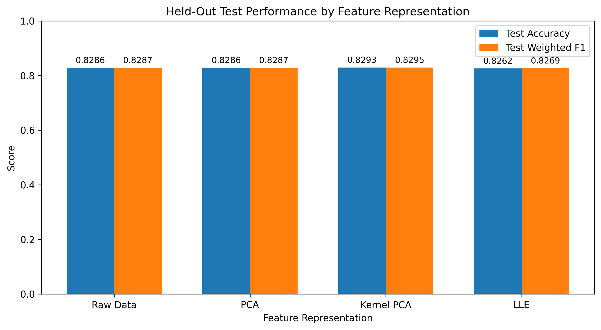

# FIFA 21 Player Position Classification

Machine learning analysis comparing raw FIFA 21 player attributes with PCA, Kernel PCA, and Locally Linear Embedding (LLE) for multiclass football position classification.

Using **K-Nearest Neighbors (KNN)** as a consistent classifier, this project evaluates whether dimensionality reduction can simplify the feature space while preserving predictive performance.

**Best held-out weighted F1: 0.8295**



---

## Project Overview

Football positions are associated with different combinations of technical, physical, attacking, defensive, and movement attributes.

This project investigates two questions:

1. Can FIFA player attributes distinguish broad positional roles?
2. Can dimensionality reduction compress the feature space without sacrificing classification performance?

Four feature representations are compared:

- Raw standardized features
- Principal Component Analysis (PCA)
- Kernel PCA with an RBF kernel
- Locally Linear Embedding (LLE)

KNN is used for every representation so that differences in performance primarily reflect the feature representation rather than the classifier.

---

## Dataset

This project uses the **FIFA 21 Complete Player Dataset** by Stefano Leone:

https://www.kaggle.com/datasets/stefanoleone992/fifa-21-complete-player-dataset

The dataset contains FIFA player attributes collected from Sofifa.

For reproducibility, the player data used by the notebook is included in this repository at:

`data/players_21.csv`

After preprocessing, the modeling dataset contains:

- **18,944 players**
- **52 numeric features**
- **6 position classes**

### Position Mapping

Detailed FIFA positions are grouped into six broader positional classes:

| Class | Included Positions |
|---|---|
| GK | GK |
| CB | CB |
| FB | LB, RB, LWB, RWB |
| CM | CDM, CM, CAM |
| Winger | LM, RM, LW, RW |
| ST | ST, CF |

For players with multiple listed positions, the dominant positional group is selected, with the listed team position used as a tie-breaker when applicable.

### Class Distribution

| Position | Players |
|---|---:|
| CM | 4,821 |
| Winger | 3,291 |
| CB | 3,152 |
| FB | 3,013 |
| ST | 2,583 |
| GK | 2,084 |

Because the classes are not perfectly balanced, **weighted F1-score** is used as the primary model-selection metric.

---

## Methodology

The data is split using stratified sampling.

The initial split produces training, validation, and test partitions. The training and validation partitions are then combined into a **development set** for cross-validated model selection, while the test set remains held out for final evaluation.

- **Development set:** 16,102 players
- **Held-out test set:** 2,842 players

The final workflow is:

1. Load and preprocess FIFA 21 player data.
2. Map detailed positions into six target classes.
3. Reserve a stratified held-out test set.
4. Tune model and representation hyperparameters using only development data.
5. Fit scaling and learned transformations only within the appropriate training data.
6. Select the best configuration using weighted F1-score.
7. Refit the selected configuration on the full development set.
8. Evaluate once on the held-out test set.

### Cross-Validation

Raw features and PCA are tuned using **5-fold stratified cross-validation**.

Kernel PCA and LLE are substantially more computationally expensive, so they are tuned using **3-fold stratified cross-validation**.

For Kernel PCA and LLE, each expensive transformed representation is reused across multiple KNN neighborhood sizes instead of recomputing the transformation for every KNN value.

Because the methods use different numbers of cross-validation folds, very small differences in CV scores should not be interpreted as direct evidence that one representation is superior.

---

## Models

### 1. Raw Features

Pipeline:

`52 features -> StandardScaler -> KNN`

Selected configuration:

- KNN neighbors: **21**

### 2. Principal Component Analysis

Pipeline:

`52 features -> StandardScaler -> PCA -> KNN`

Selected configuration:

- PCA components: **50**
- KNN neighbors: **21**

The selected 50 PCA components retain approximately **99.996% of total variance**.

### 3. Kernel PCA

Pipeline:

`52 features -> StandardScaler -> RBF Kernel PCA -> KNN`

Selected configuration:

- Components: **50**
- Gamma: **0.001**
- KNN neighbors: **30**

### 4. Locally Linear Embedding

Pipeline:

`52 features -> StandardScaler -> LLE -> KNN`

Selected configuration:

- Components: **50**
- LLE neighbors: **120**
- KNN neighbors: **30**

---

## Final Results

| Representation | Selected Parameters | CV Weighted F1 | Test Accuracy | Test Weighted F1 |
|---|---|---:|---:|---:|
| Raw Features | k = 21 | **0.8322** | 0.8286 | 0.8287 |
| PCA | 50 components, k = 21 | **0.8322** | 0.8286 | 0.8287 |
| Kernel PCA | 50 components, gamma = 0.001, k = 30 | 0.8304 | **0.8293** | **0.8295** |
| LLE | 50 components, 120 neighbors, k = 30 | 0.8280 | 0.8262 | 0.8269 |

Kernel PCA produced the highest numerical held-out weighted F1 at **0.8295**, but its advantage over the raw-feature baseline was only **0.0008**.

The four representations therefore produced essentially equivalent held-out classification performance.

> **Main finding:** dimensionality reduction preserved baseline performance only when nearly the entire original feature space was retained.

---

## Dimensionality Reduction Analysis


PCA shows that substantially fewer components capture most of the dataset's total variance, but the strongest classification performance requires nearly all 52 dimensions.

The selected PCA configuration uses:

- **50 of 52 components**
- **99.996% cumulative explained variance**

This suggests that some relatively low-variance directions still contain information useful for distinguishing player positions.

In other words:

> **Explained variance is not the same as predictive information.**

PCA is unsupervised and optimizes retained variance rather than class separation, so dimensions that explain relatively little total variance can still contribute to classification.

---

## Class-Level Performance


Class-level performance varies across positional groups.

Several outfield roles share combinations of attributes such as pace, passing, dribbling, movement, attacking ability, and defensive ability. This creates overlap between neighboring positional groups and makes some classes harder to distinguish than others.

---

## Error Analysis

Final confusion matrices are included in the `figures/` directory:

- `confusion_matrix_raw_data.png`
- `confusion_matrix_pca.png`
- `confusion_matrix_kernel_pca.png`
- `confusion_matrix_lle.png`

These figures show which positional groups are most frequently confused and how similar the error patterns are across the four feature representations.

---

## Key Findings

- Standardized raw features provide a strong baseline at **0.8287 weighted F1**.
- PCA matches the raw baseline but requires **50 of 52 components**, providing almost no practical compression.
- Kernel PCA records the highest numerical held-out weighted F1 at **0.8295**, but the improvement over raw features is too small to represent a meaningful predictive advantage.
- LLE also requires a 50-dimensional embedding and a relatively large neighborhood to approach baseline performance.
- All three dimensionality-reduction methods require nearly the full original dimensionality to preserve classification performance.
- Useful positional information appears to be distributed across much of the original FIFA feature space.
- Aggressive dimensionality reduction removes information that helps distinguish positional roles.

---

## Repository Structure

```text
fifa-position-classification/
├── data/
│   └── players_21.csv
├── figures/
│   ├── model_performance_comparison.png
│   ├── pca_explained_variance.png
│   ├── per_class_f1_comparison.png
│   ├── confusion_matrix_raw_data.png
│   ├── confusion_matrix_pca.png
│   ├── confusion_matrix_kernel_pca.png
│   └── confusion_matrix_lle.png
├── notebooks/
│   └── fifa_position_classification.ipynb
├── .gitignore
├── README.md
└── requirements.txt
```

---

## Technologies

### Data Analysis

- Python
- pandas
- NumPy

### Machine Learning

- scikit-learn
- K-Nearest Neighbors
- StandardScaler
- Principal Component Analysis
- Kernel PCA
- Locally Linear Embedding
- GridSearchCV
- StratifiedKFold

### Visualization and Development

- Matplotlib
- Jupyter Notebook
- Google Colab
- Git
- GitHub

---

## Running the Project

### 1. Clone the repository

```bash
git clone https://github.com/gabebekele/fifa-position-classification.git
cd fifa-position-classification
```

### 2. Install dependencies

```bash
pip install -r requirements.txt
```

### 3. Run the notebook

The dataset is already included in:

```text
data/players_21.csv
```

The notebook is located at:

```text
notebooks/fifa_position_classification.ipynb
```

If running locally with Jupyter:

```bash
jupyter notebook notebooks/fifa_position_classification.ipynb
```

The notebook can also be opened and run in Google Colab.

### Dataset Path

When running the notebook from the `notebooks/` directory, the dataset can be loaded with:

```python
df = pd.read_csv("../data/players_21.csv")
```

---

## Reproducibility

The project uses fixed random seeds where supported:

```python
random_state=42
```

The held-out test set is not used for hyperparameter selection.

The modeling workflow separates model selection from final evaluation:

```text
Development Data
      |
      v
Stratified Cross-Validation
      |
      v
Preprocessing + Representation Learning
      |
      v
KNN Hyperparameter Selection
      |
      v
Refit on Full Development Set
      |
      v
Held-Out Test Evaluation
```

---

## Limitations

- The six target classes simplify the more nuanced positional roles used in football.
- FIFA ratings are video-game attributes rather than direct player-tracking or physical-performance measurements.
- KNN performance depends strongly on scaling and the geometry of the feature space.
- The strongest dimensionality-reduction configurations retain 50 of 52 dimensions, so they provide little practical compression.
- Raw/PCA and Kernel PCA/LLE use different cross-validation fold counts because of computational cost, so small differences in CV scores should not be interpreted as direct model rankings.

---

## Dataset License

The included FIFA 21 dataset originates from the Kaggle **FIFA 21 Complete Player Dataset** published by Stefano Leone:

https://www.kaggle.com/datasets/stefanoleone992/fifa-21-complete-player-dataset

Kaggle lists the dataset under the **CC0: Public Domain** license.

---

## Conclusion

FIFA 21 player attributes can classify six broad positional roles with approximately **83% held-out accuracy and weighted F1-score** using K-Nearest Neighbors.

PCA, Kernel PCA, and LLE all preserve approximately the same classification performance as standardized raw features, but each requires **50 of the original 52 dimensions** at its strongest configuration.

The experiment therefore shows that aggressive dimensionality reduction does not improve this task. Instead, useful positional information appears to be distributed across much of the original FIFA feature space.
